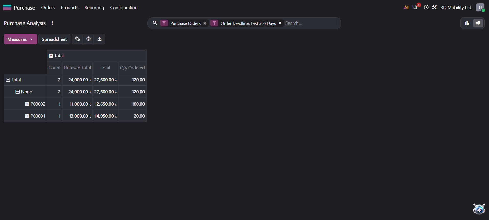
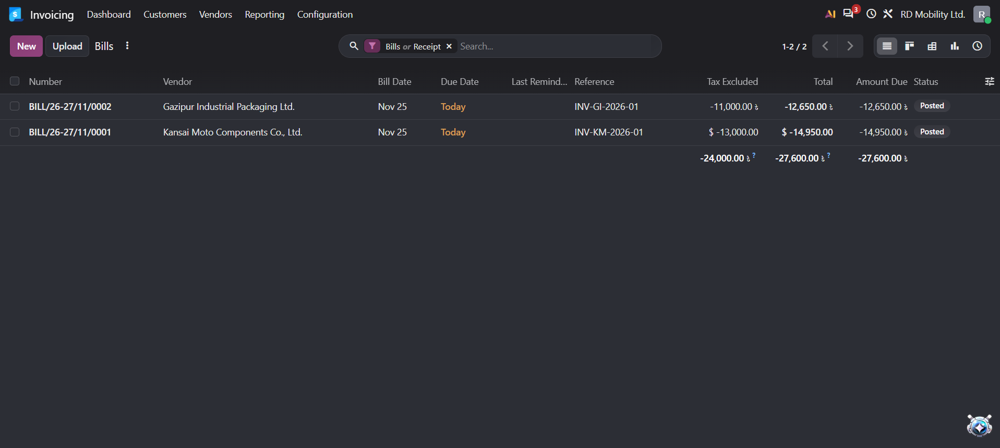

# RD Mobility Ltd. — Odoo Online (v19) ERP Mini-Project

Self-directed ERP configuration and workflow exercise built on **Odoo Online (v19)** modeling **RD Mobility Ltd.** across multi-currency procurement, warehouse stock tracking, and vendor billing.

## Scope & Master Data
- **Company:** RD Mobility Ltd. (Odoo Online v19)
- **Currencies:** USD (international vendor) and BDT (local vendor and company valuation)
- **Vendors:**
  - *Kansai Moto Components Co., Ltd.* (USD)
  - *Gazipur Industrial Packaging Ltd.* (BDT)
- **Products (SKUs):**
  - `[ENG-150-CKD] 150cc Engine Assembly Kit (CKD)`
  - `[LMP-LED-01] LED Headlamp Unit - Type A`
  - `[PKG-CRTN-HD] Heavy-Duty Corrugated Carton`
- **Warehouse & Inventory Setup:** Storage locations, multi-step routes enabled, and reordering rules configured.

## Workflows Executed
1. **Automated Import Procure-to-Pay (USD):** Configured reordering rules, generated/confirmed Purchase Order `P00001` for 20 units of the 150cc Engine Assembly Kit (CKD) with Kansai Moto Components Co., Ltd., validated the goods receipt into `WH/Stock`, and posted vendor bill `BILL/26-27/11/0001` (`INV-KM-2026-01`) in Invoicing.
2. **Manual Local Procure-to-Pay (BDT):** Created and confirmed a BDT Purchase Order for 100 units of Heavy-Duty Corrugated Carton with Gazipur Industrial Packaging Ltd., validated the receipt into `WH/Stock`, and posted vendor bill `BILL/26-27/11/0002` (`INV-GI-2026-01`).
3. **Reporting & Verification:** Reviewed Purchase Analysis, Inventory Stock (`On Hand`, `Free to Use`, `Unit Cost`, `Total Value`, `Incoming`, and `Outgoing`), and Vendor Bills to verify transaction consistency.

## Key Views & Screenshots
### Purchase Analysis (Pivot View)
Shows procurement breakdown across vendors and items.

### Inventory Stock
Shows received quantities in `WH/Stock`, unit costs, and total stock valuation.

### Posted Vendor Bills
Shows confirmed USD and BDT vendor bills in `Posted` status.

